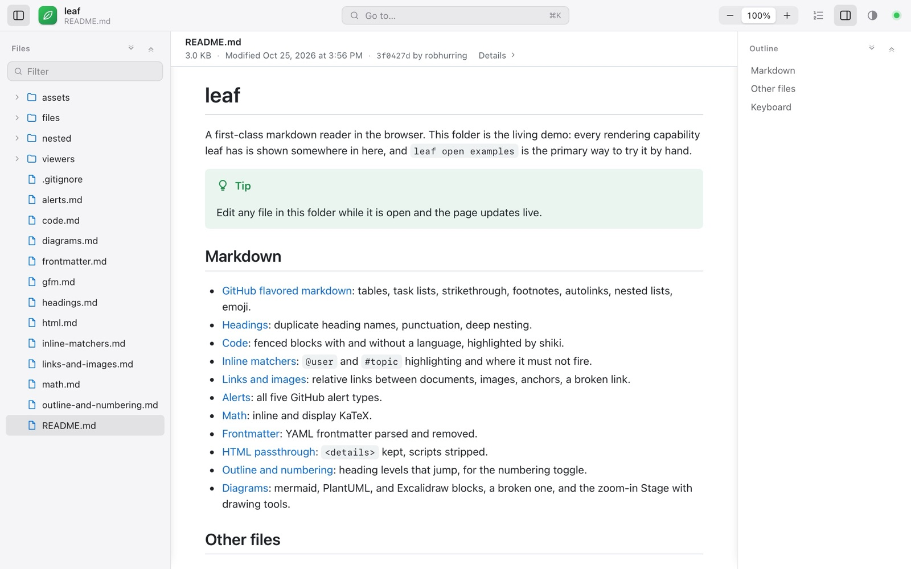
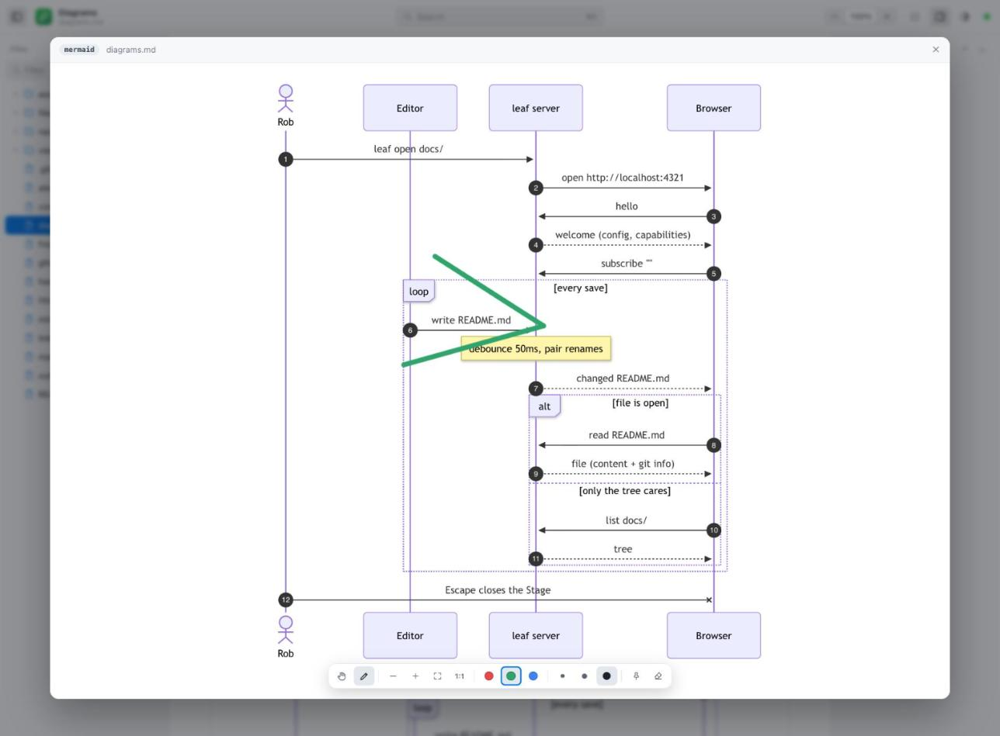
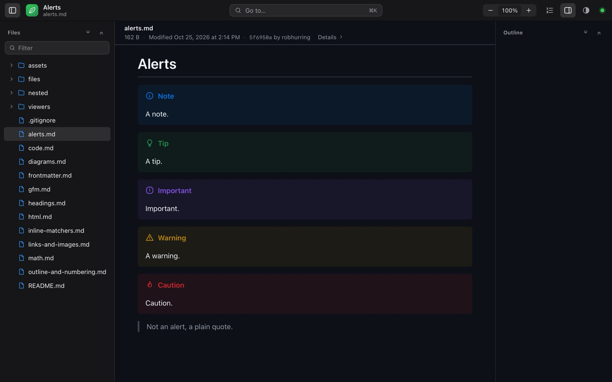

# leaf

View markdown beautifully.

```sh
leaf open README.md
```

That opens the file in a leaf reader window, rendered the way GitHub renders it, and keeps it in sync while the file changes. Point it at a folder and you get a file tree, an outline, and search across every file. Your terminal comes straight back.



## Install

leaf is one native binary with the reader inside it, for macOS and Linux. Until packaged builds exist, build it from a checkout (Rust and Node 22 or newer):

```sh
bin/setup                  # dependencies
bin/install                # builds, then links `leaf` into ~/.local/bin
```

On macOS `bin/install` also puts `leaf reader.app` in `~/Applications` so `leaf://` links open in leaf; `bin/install --uninstall` removes both. Its icon follows light and dark mode; `LEAF_ICON=vein-arrow` or `LEAF_ICON=page` before `bin/install` (or `bin/build`) picks one of the other two designs.

## Use

```sh
leaf open README.md        # one file
leaf open docs/            # a folder: tree, outline, search
leaf open .                # a whole repo, .gitignore respected
```

`leaf open` puts a window on your dock and returns, like `open`. Running it again opens another window in the same app. The View menu switches light and dark, the sidebars, numbering, and text size; File > Open Folder… opens anything else. Drag a sidebar's edge to resize it.

### Links

Other apps can link straight to a document:

```sh
open 'leaf://open/Users/me/notes/plan.md'                   # an absolute path; ~/notes/plan.md works too
open 'leaf://open/Users/me/notes/plan.md#next-steps'        # and scroll to a heading
open 'leaf://open/Users/me/notes/plan.md?root=/Users/me/notes'   # inside its folder, with the tree
open 'leaf://open/Users/me/notes/plan.md?browser'           # in the browser instead
```

A window already showing that file, or the folder it lives in, comes forward and opens it; otherwise a new window opens. `leaf 'leaf://…'` does the same from a terminal.

For a browser instead, or a socket for agents and tools:

```sh
leaf open --browser docs/  # a tab; the server goes away when the tab closes
leaf serve docs/           # foreground server on 127.0.0.1:4321, ctrl-c to stop
leaf serve docs/ -l debug  # same, with every message on the wire
```

## What you get

Everything GitHub renders, rendered the same way: tables, task lists, footnotes, alerts, emoji, math, frontmatter, syntax highlighting for a hundred languages, Mermaid diagrams.

Then the parts a static page can't do:

- **Live.** Edit the file in your editor, or let an agent write it, and the page follows. No reload, no flash, and the scroll position stays put.
- **Zoom in.** Hover a diagram to zoom it and pan it where it sits, or open the zoomed view to pinch, pan, and draw on it with a pencil. Ink fades on its own unless you pin it. Copy the picture to the clipboard or download the SVG.
- **More diagrams.** PlantUML and Excalidraw next to Mermaid. A broken diagram shows its error in place instead of a blank box.
- **Find anything.** `⌘K` searches headings, file names, and the text of every file in the folder from one box; `⌘F` finds in the open document.
- **File header.** The path and when the file was created and changed sit above the document, with the last commit beneath it as a `git log` line, linked to your remote along with its pull request. Properties opens the frontmatter and file details in place. Links to the web open in your browser. Code, CSV, diagram, and image files fill the window, their controls in a toolbar under the header. A diagram file opens ready to pan, zoom, and draw on.
- **Mentions and topics.** `@user` and `#topic` light up and link where you say, or to GitHub when you're inside a GitHub checkout.
- **Blame.** For a file in git, the blame button in the file header adds a column beside the text: each block of a document (each run of lines in code) shows its commit, author, and age, with the commit and its pull request linked, and the commit message under them. Newer changes are tinted deeper; changes not yet committed are amber. Drag the column's edge to resize it; it steps aside when the window is too narrow.
- **Other files too.** Code in a read-only editor with line selection you can link to, CSV as a sortable, filterable table, images on a checkerboard, media, and a card for anything else.
- **Native, light and dark.** The window is a Mac app: title bar, menus, system font. Light, dark, or follow the system, remembered across runs along with the sidebars, numbering, and text size. In a browser, GitHub, Glass, Card, and Paper change how the document reads.





## Keyboard

| Keys            | Action                                        |
| --------------- | --------------------------------------------- |
| `⌘K`            | go to a heading, a file, or text anywhere     |
| `⌘O`            | go to a file                                  |
| `⌘F`            | find in the document; `enter` for the next    |
| `j` `k`         | scroll by a line, `^d` `^u` by half a page    |
| `^f` `^b`       | scroll by a page                              |
| `^n` `^p`       | next and previous heading, or list item       |
| `[` `]`         | toggle the file tree, the outline             |
| `n` `t`         | number the headings, switch light and dark    |
| `1` `2` `space` | in a zoom-in: hand, pencil, hold for the hand |
| `esc`           | close whatever is open                        |

## Reading with others

The page is driven entirely by a small WebSocket protocol: a hello, a file tree, a file, a change. The server that speaks it today reads your disk. The same page can read from anything else that speaks it, which is how a document on your machine becomes one that people and agents elsewhere are reading and annotating together. That part is coming.

## Configuration

Flags, environment variables, or a `.env` next to where you run it, in that order of precedence. `.env.example` lists them all; the ones you might touch:

| Variable            | Default          | What it does                                                  |
| ------------------- | ---------------- | ------------------------------------------------------------- |
| `PORT`              | `4321`           | falls back to a free port when busy                           |
| `LOG_LEVEL`         | `warn`           | `info` for the traffic, `debug` for every payload             |
| `LEAF_IDLE_TIMEOUT` | `10s`            | how long after the last tab closes a `--browser` server stops |
| `PLANTUML_URL`      | unset            | a PlantUML server; `docker compose up -d` runs one locally    |
| `LEAF_MENTION_URL`  | unset            | where `@user` links, with `{username}` in it                  |
| `LEAF_CONFIG_DIR`   | `~/.config/leaf` | preferences, running instances, logs                          |

## Hacking on it

```sh
bin/setup      # install, .env, Playwright's browsers, checks for cargo
bin/dev -o     # server plus Vite on examples/, opens the browser
bin/test       # Rust and UI unit tests, build, browser smoke tests on three engines
bin/install    # build, then symlink target/release/leaf into ~/.local/bin
```

`examples/` is the living demo: every feature has a file there, and `leaf open examples` is how to see it.

The Rust side is a Cargo workspace in `crates/`: `leaf-protocol` (the message types, tested against the JSON Schema export), `leaf-core` (disk, watcher, preferences, and the transport-free engine), and `leaf-app` (the `leaf` binary: the window, serve mode, the CLI). The web side is in `packages/`: `protocol` (the message schemas, the source of truth both sides are tested against) and `ui` (the React reader that runs in the window and in browsers). Design docs live in `.superpowers/specs/`, plans in `.superpowers/plans/`.
