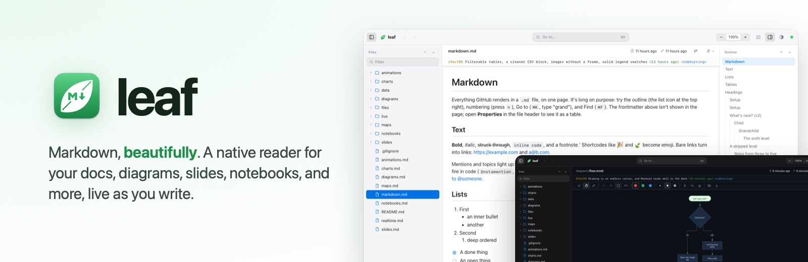
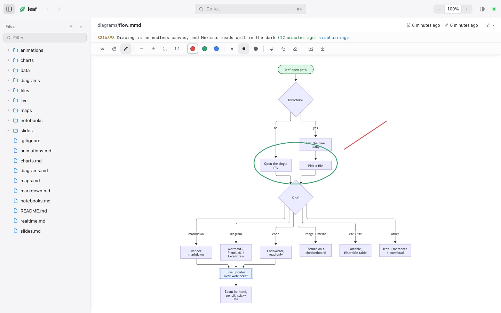
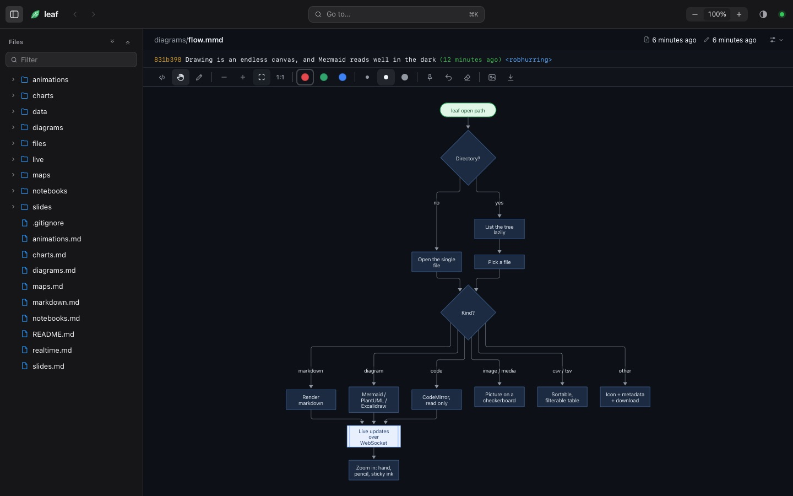
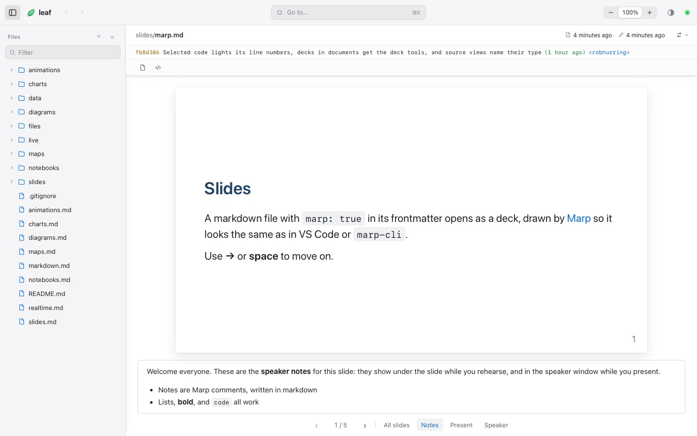
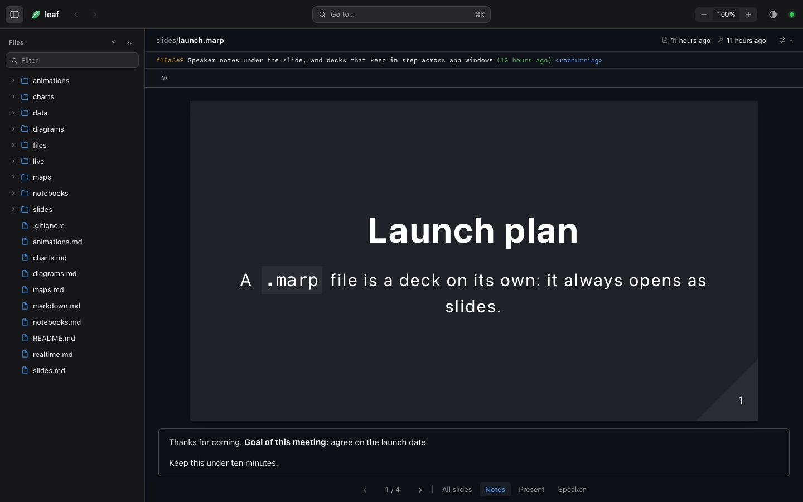
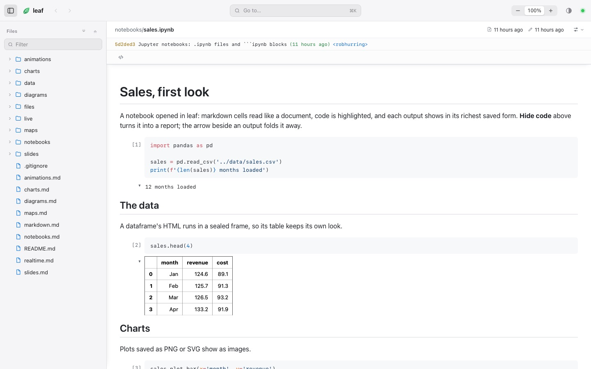
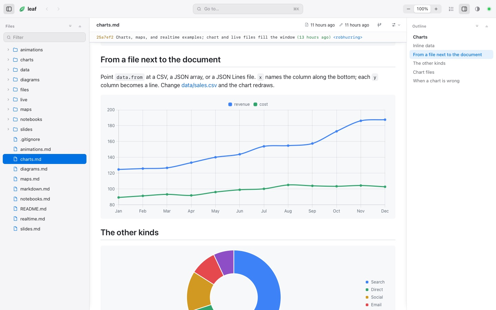
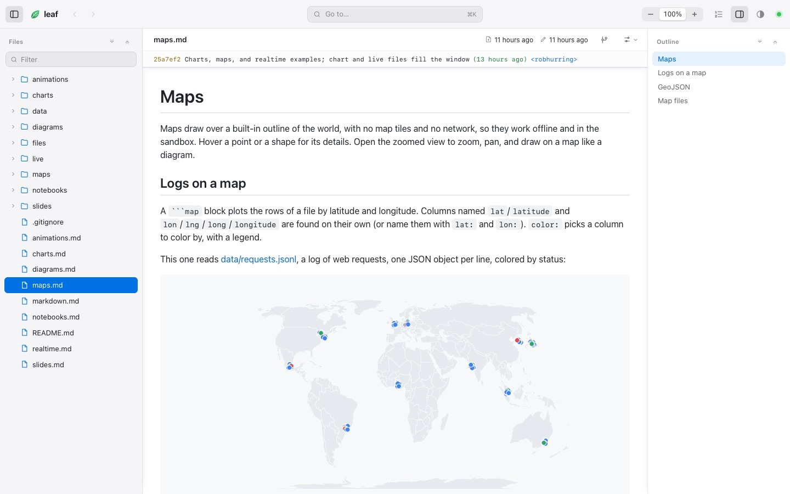
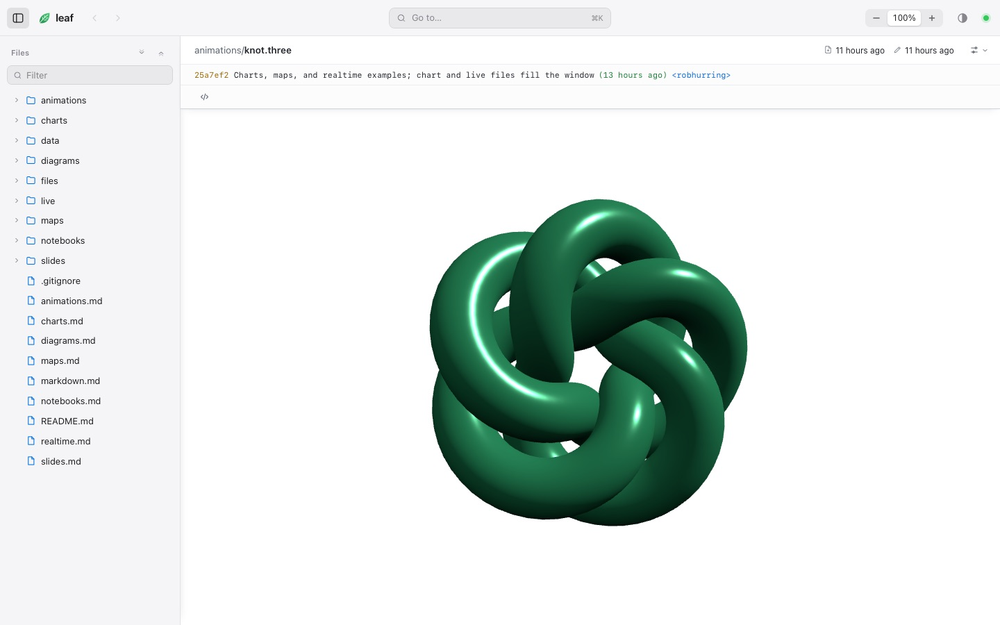
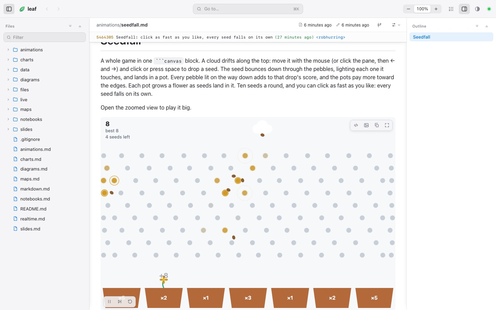

<p align="center"></p>

leaf is a native reader for the files that live next to your code. Point it at a markdown file or a whole repo and it renders everything the way GitHub does, then goes further: diagrams you can zoom into and draw on, slide decks, Jupyter notebooks, charts, maps, live 3D and canvas animations, and code with blame. Edit the file in your editor, or let an agent write it, and the page follows as you save.

It's one binary for macOS and Linux. `leaf open` puts a window on your dock and hands your terminal straight back.

## Try it

```sh
brew install --cask robhurring/tap/leaf   # macOS (other ways under Install)
leaf open ~/notes                         # any folder or file
```

From a checkout, `leaf open docs/examples` is the tour: every kind of file leaf reads, one page each. [`docs/examples`](docs/examples/README.md) is the living demo. Start at its README and click through: markdown, diagrams, slides, notebooks, charts, maps, animations, and a couple of small games.

<table>
  <tr>
    <td></td>
    <td></td>
  </tr>
  <tr>
    <td align="center"><sub><b>Markdown.</b> Everything GitHub renders, with a file tree, an outline, and search.</sub></td>
    <td align="center"><sub><b>Light and dark.</b> Follows the system, or pick one.</sub></td>
  </tr>
  <tr>
    <td></td>
    <td></td>
  </tr>
  <tr>
    <td align="center"><sub><b>Diagrams.</b> Mermaid, PlantUML, Excalidraw. Zoom, pan, and draw on them.</sub></td>
    <td align="center"><sub><b>Dark diagrams</b> get their own palette, not a filter.</sub></td>
  </tr>
  <tr>
    <td></td>
    <td></td>
  </tr>
  <tr>
    <td align="center"><sub><b>Slides.</b> Marp decks with notes, present mode, and a speaker window.</sub></td>
    <td align="center"><sub><b>Any Marp theme</b>, drawn by Marp itself.</sub></td>
  </tr>
  <tr>
    <td></td>
    <td></td>
  </tr>
  <tr>
    <td align="center"><sub><b>Notebooks.</b> Read a <code>.ipynb</code> like a report, outputs and all.</sub></td>
    <td align="center"><sub><b>Charts</b> from a few lines of YAML, or a CSV next to the document.</sub></td>
  </tr>
  <tr>
    <td></td>
    <td></td>
  </tr>
  <tr>
    <td align="center"><sub><b>Maps</b> of a log or a GeoJSON file, offline.</sub></td>
    <td align="center"><sub><b>Live 3D and canvas</b> blocks, sandboxed.</sub></td>
  </tr>
</table>

<p align="center"><br><sub><b>Seedfall</b>, a whole game in one <code>```canvas</code> block.</sub></p>

## Install

Three ways in: Homebrew, a release download, or a build from source. leaf runs on Apple Silicon and Intel Macs; on Linux, build from source.

### Homebrew (macOS, recommended)

Installs **leaf reader** in Applications and `leaf` in your terminal. Each release updates [the tap](https://github.com/robhurring/homebrew-tap).

```sh
brew install --cask robhurring/tap/leaf
brew upgrade --cask leaf                  # a newer release
brew uninstall --cask leaf                # add --zap to remove ~/.config/leaf too
```

### Download a release (macOS)

Download the `.dmg` (or `.zip`) from [Releases](https://github.com/robhurring/leaf/releases) and drag **leaf reader** to Applications. To get `leaf` in your terminal, link the binary inside the app:

```sh
ln -s "/Applications/leaf reader.app/Contents/MacOS/leaf" /usr/local/bin/leaf
```

Builds that aren't notarized yet are stopped the first time you open them: open **System Settings > Privacy & Security** and choose **Open Anyway**. Homebrew installs get the same prompt.

### Build from source (macOS and Linux)

With Rust and Node 22 or newer:

```sh
git clone https://github.com/robhurring/leaf && cd leaf
bin/setup                  # dependencies, .env, and the browsers the tests use
bin/install                # builds, then links `leaf` into ~/.local/bin
bin/build                  # after a pull: rebuilds `leaf` and (macOS) the app
```

On macOS `bin/build` (and so `bin/install`) also builds `leaf reader.app` in `~/Applications`, so Finder and `leaf://` links open what you just built (`LEAF_BUNDLE=0 bin/build` leaves it alone); `bin/install --uninstall` removes both. Its icon follows light and dark mode; `LEAF_ICON=vein-arrow` or `LEAF_ICON=page` before `bin/install` (or `bin/build`) picks one of the other two designs.

## Use

```sh
leaf open README.md        # one file
leaf open docs/            # a folder: tree, outline, search
leaf open .                # a whole repo, .gitignore respected
```

`leaf open` puts a window on your dock and returns, like `open`. Running it again opens another window in the same app. The View menu switches light and dark, the sidebars, numbering, and text size; File > Open Folder… opens anything else. Drag a sidebar's edge to resize it.

### Links

Other apps can link straight to a document:

```sh
open 'leaf://open/Users/me/notes/plan.md'                   # an absolute path; ~/notes/plan.md works too
open 'leaf://open/Users/me/notes/plan.md#next-steps'        # and scroll to a heading
open 'leaf://open/Users/me/notes/plan.md?root=/Users/me/notes'   # inside its folder, with the tree
open 'leaf://open/Users/me/notes/plan.md?browser'           # in the browser instead
```

A window already showing that file, or the folder it lives in, comes forward and opens it; otherwise a new window opens. `leaf 'leaf://…'` does the same from a terminal.

### In a browser, or on a server

The same reader runs in any browser: it's what people you share with will see.

```sh
leaf open --browser docs/  # in your browser; the server stops when the tab closes
leaf serve docs/           # a server that stays up, on 127.0.0.1:4321 (ctrl-c stops it)
leaf serve docs/ -l debug  # same, with every message on the wire
leaf relay start           # a relay for sharing (see Sharing)
```

`serve` is for a folder on another machine (`--host 0.0.0.0` on a dev box or a server with no desktop, read from your laptop) and for development: `bin/dev` and the browser tests run it.

## Sharing

Share a tab and others read it with you, live: they land where you are and browse the tab on their own, the page follows your edits, and they can't change anything. Sharing goes through a **relay**, a small server you run (below); the app reaches it with `LEAF_RELAY_URL`.

```sh
LEAF_RELAY_URL=https://my-relay.herokuapp.com leaf open docs/
```

Or put `LEAF_RELAY_URL` in your `.env` or pass `--relay-url`. With a relay set, the window gains a Share menu (without one there is no Share button). **Share this tab** starts a session for the tab you're on, then the menu offers:

- **Copy app link**: a `leaf://relay/<relay-host>/s/<id>` link. It opens in leaf once `leaf connect` ships, in the next release.
- **Copy web link**: `https://<relay>/s/<id>`, which opens the reader in any browser, with a banner naming the host, who's here, and what the host is reading.
- **End session**: stops sharing and disconnects everyone.

A shared tab wears a mark in the tab row (in the title row when the window has one tab).

What viewers can and can't do:

- They browse the tab's tree on their own: open other files in it without moving you, and the other way round.
- It's read-only. Nothing they do changes your files.
- Code runs only when they click Run: live blocks and notebook outputs in a share don't start by themselves.
- Files your ignore rules skip, and anything outside the tab's folder, stay private.

Close the tab or the window by accident and you have 60 seconds (`LEAF_RELAY_GRACE`) to come back before the session ends for everyone; for those 60 seconds the Share menu offers **Resume sharing**.

### Running a relay

```sh
LEAF_RELAY_PUBLIC_URL=http://localhost:4321 leaf relay start   # listens on $PORT (default 4321)
```

Then `LEAF_RELAY_URL=http://localhost:4321 leaf open docs/` to share through it. As a container:

```sh
docker build -t leaf-relay . && docker run --rm -e PORT=8080 -p 8080:8080 leaf-relay
```

| Variable                 | Default | What it does                                                                                  |
| ------------------------ | ------- | --------------------------------------------------------------------------------------------- |
| `PORT`                   | `4321`  | the port the relay listens on, on all interfaces                                              |
| `LEAF_RELAY_SECRET`      | random  | signs host tokens; set it so hosts keep their links across restarts (the relay warns without) |
| `LEAF_RELAY_PUBLIC_URL`  | unset   | the relay's own address, the base of the links it hands out                                   |
| `LEAF_RELAY_GRACE`       | `60`    | seconds a session survives its host disconnecting                                             |
| `LEAF_RELAY_TRUST_PROXY` | unset   | truthy behind a proxy (Heroku's router): the rate limit uses the real client address          |

On Heroku, which runs the `Dockerfile` through the container stack (`heroku.yml`):

```sh
heroku create
heroku stack:set container
heroku config:set LEAF_RELAY_SECRET=$(openssl rand -hex 32) LEAF_RELAY_TRUST_PROXY=1 LEAF_RELAY_PUBLIC_URL=https://<app>.herokuapp.com
git push heroku main
```

The `Procfile` (`web: leaf relay start`) is for platforms that build from source instead.

## What you get

Everything GitHub renders, rendered the same way: tables, task lists, footnotes, alerts, emoji, math, frontmatter, syntax highlighting for a hundred languages, Mermaid diagrams.

Then the parts a static page can't do:

- **Live.** Edit the file in your editor, or let an agent write it, and the page follows. No reload, no flash, and the scroll position stays put.
- **Zoom in and draw.** Hover a diagram to zoom and pan it where it sits, or open the zoomed view to pinch, pan, and draw on it: ink colors, brush sizes, ink that fades or sticks, undo (`⌘Z`), and clear. **Copy as image** and **Download SVG** include what you drew.
- **More diagrams.** PlantUML and Excalidraw next to Mermaid. Mermaid has a dark palette of its own. A broken diagram shows its error in place instead of a blank box.
- **Drawing.** A ` ```draw ` block, or a `.draw` file, is an endless canvas with the same tools. Copy or download crops to what you drew.
- **Slides.** A markdown file with `marp: true` (or a `.marp` file) opens as a [Marp](https://marp.app) deck, drawn by Marp itself: arrows or a click to move (the cursor shows which way), **All slides**, **Notes**, **Present** to fill the screen, and **Speaker** for a second window with the notes, the next slide, a timer, and the clock, kept in step both ways. A ` ```marp ` block puts a deck with the same tools inside any document.
- **Notebooks.** `.ipynb` files read like documents: markdown cells, highlighted code with its count, and saved outputs (images, tables, markdown, errors); hide the code to read it as a report, fold any output. A ` ```ipynb ` block embeds one.
- **Charts and maps.** A ` ```chart ` block is a Chart.js config as YAML; a ` ```map ` block plots a CSV or a log by latitude and longitude; GeoJSON and TopoJSON draw as maps over a built-in world, with no network. Data can live in a file beside the document, and the chart or map redraws when it changes. `.chart`, `.geojson`, `.topojson`, `.three`, `.sketch`, and `.draw` files open full window.
- **Animations.** A ` ```three ` or ` ```canvas ` block runs as a live pane, for illustrating an idea while you present: drag a 3D scene around, step through a sort, or play a game. See [Live animation blocks](#live-animation-blocks).
- **Source, one click away.** Every diagram, chart, map, deck, table, and animation flips to its source and back, with its language shown, and copies it.
- **Find anything.** `⌘K` searches headings, file names, and the text of every file in the folder from one box (and, with tabs, the window's other tabs); `⌘F` finds in the open document.
- **Tabs.** A window can hold several tabs, each its own workspace: a file or a folder, with its own tree and history. `⌘-click` a file in the tree (or right-click, Open in New Tab) to open it in a new tab on the same folder, `⌘T` for a new tab. Drag a tab along the row to reorder it, off the window to give it its own, or onto another window's tab row to move it there, live. A window with one tab has no tab row: drag its leaf mark onto another window instead. Settings decides whether `leaf open` opens a new window (the default) or a tab in the front one.
- **File header.** The path and when the file was created and changed sit above the document, with the last commit beneath it as a `git log` line, linked to your remote along with its pull request. Properties opens the frontmatter and file details in place. Code, CSV, diagram, and image files fill the window, their controls in a toolbar under the header.
- **Mentions and topics.** `@user` and `#topic` light up and link where you say, or to GitHub when you're inside a GitHub checkout.
- **Blame.** For a file in git, the blame button in the file header adds a column beside the text: each block of a document (each run of lines in code) shows its commit, author, and age, with the commit and its pull request linked. Newer changes are tinted deeper; changes not yet committed are amber.
- **Other files too.** Code in a read-only editor where selecting lines (by number or with the mouse) highlights them and gives you a link, CSV as a sortable, filterable table, images on a checkerboard, media, and a card for anything else. Files over 2 MB show as a card instead of loading.
- **Native, light and dark.** The window is a Mac app: title bar, menus, system font. Light, dark, or follow the system, remembered across runs along with the sidebars, numbering, and text size. In a browser, GitHub, Glass, Card, and Paper change how the document reads.

## Live animation blocks

Two fence languages run their code instead of showing it:

- ` ```three ` gets `THREE` and `OrbitControls`, plus a `scene`, a `camera` (at `z = 5`), and a `renderer` already sized to the pane. leaf draws the scene every frame; call `manual()` to draw it yourself.
- ` ```canvas ` gets a `canvas` and its 2D `ctx`, already scaled for the screen, with `width` and `height` in CSS pixels.

Both get `onFrame(fn)`, which calls `fn(t, dt)` every frame with the milliseconds since the pane started and since the last frame, and `theme` (`'light'` or `'dark'`, with a `themechange` event on `window` when it changes). The code runs as the body of an async function, so `await` works at the top. A pane is 320 pixels tall; set another height in the fence: ` ```three height=480 `.

Each pane runs in a sandboxed frame: it can't reach leaf, your files, or the network, so a document from anyone is safe to open. It plays only while it's on screen, and rests when the window is hidden or you pause it; with reduced motion on, it starts paused on its first frame. An error shows under the pane with its line. See [docs/examples/animations.md](docs/examples/animations.md).

## Settings

⌘, (or Settings… in the appearance menu) opens Settings. **Windows** chooses where `leaf open`, links, and Open Folder put what they open: a new window (the default), or a new tab of the front window. **Reopen my tabs when leaf starts** (off by default) brings back the windows and tabs open when you quit, less any whose file or folder is gone. **Links to other apps** lists the kinds of link the leaf window hands to your Mac: the web, mail, and editors (`vscode`, `vscode-insiders`, `cursor`, `windsurf`, `zed`) to start. Add a kind such as `obsidian`, remove one, or restore the defaults; it's saved with your other preferences. `javascript:`, `file:`, and `data:` links never open.

## Keyboard

| Keys            | Action                                        |
| --------------- | --------------------------------------------- |
| `⌘K`            | go to a heading, a file, or text anywhere     |
| `⌘O`            | go to a file                                  |
| `⌘F`            | find in the document; `enter` for the next    |
| `j` `k`         | scroll by a line, `^d` `^u` by half a page    |
| `^f` `^b`       | scroll by a page                              |
| `^n` `^p`       | next and previous heading, or list item       |
| `[` `]`         | toggle the file tree, the outline             |
| `⌘T` `⌘W`       | new tab, close tab (`⌘⇧W` closes the window)  |
| `⌘⇧]` `⌘⇧[`     | next and previous tab; `⌘1`…`⌘9` pick one     |
| `⌘,`            | Settings                                      |
| `n` `t`         | number the headings, switch light and dark    |
| `1` `2` `space` | in a zoom-in: hand, pencil, hold for the hand |
| `esc`           | close whatever is open                        |

## Reading with others

The page is driven entirely by a small WebSocket protocol: a hello, a file tree, a file, a change. The server that speaks it today reads your disk. The same page can read from anything else that speaks it, which is how a document on your machine becomes one that people and agents elsewhere are reading and annotating together. That part is coming.

## Configuration

Flags, environment variables, or a `.env` next to where you run it, in that order of precedence. `.env.example` lists them all; the ones you might touch:

| Variable            | Default          | What it does                                                  |
| ------------------- | ---------------- | ------------------------------------------------------------- |
| `PORT`              | `4321`           | falls back to a free port when busy                           |
| `LOG_LEVEL`         | `warn`           | `info` for the traffic, `debug` for every payload             |
| `LEAF_IDLE_TIMEOUT` | `10s`            | how long after the last tab closes a `--browser` server stops |
| `PLANTUML_URL`      | unset            | a PlantUML server; `docker compose up -d` runs one locally    |
| `LEAF_MENTION_URL`  | unset            | where `@user` links, with `{username}` in it                  |
| `LEAF_CONFIG_DIR`   | `~/.config/leaf` | preferences, running instances, logs                          |

## Hacking on it

```sh
bin/setup      # install, .env, Playwright's browsers, checks for cargo
bin/dev -o     # server plus Vite on docs/examples/, opens the browser
bin/test       # Rust and UI unit tests, build, browser smoke tests on three engines
bin/install    # build, then symlink target/release/leaf into ~/.local/bin
bin/package    # (macOS) the release app as a .dmg and a .zip in dist/release/
bin/release    # the next minor version (or bin/release 1.2.3): bump, check, tag, push; CI builds the release
bin/clean      # delete build output (target/ grows by gigabytes); --all adds node_modules
```

Releases: bump `version` in `Cargo.toml`, merge to main, and push a matching tag (`git tag v0.2.0 && git push origin v0.2.0`). The release workflow builds a universal app, packages it, and publishes a GitHub release. With an Apple Developer ID in the repository secrets (`APPLE_CERTIFICATE`, `APPLE_CERTIFICATE_PASSWORD`, `APPLE_SIGNING_IDENTITY`, `APPLE_ID`, `APPLE_PASSWORD`, `APPLE_TEAM_ID`) it is signed and notarized; without one it is signed ad hoc.

`docs/examples/` is the living demo: [its README](docs/examples/README.md) maps every feature to a page, and `leaf open docs/examples` is how to see it.

The Rust side is a Cargo workspace in `crates/`: `leaf-protocol` (the message types, tested against the JSON Schema export), `leaf-core` (disk, watcher, preferences, and the transport-free engine), and `leaf-app` (the `leaf` binary: the window, serve mode, the CLI). The web side is in `packages/`: `protocol` (the message schemas, the source of truth both sides are tested against) and `ui` (the React reader that runs in the window and in browsers).
