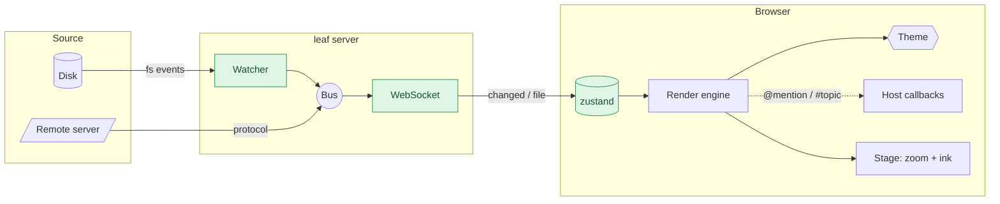
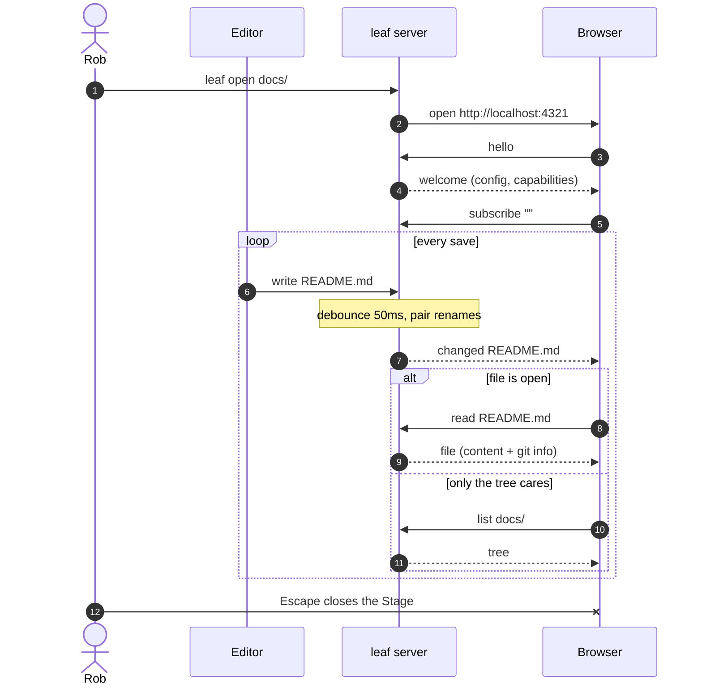
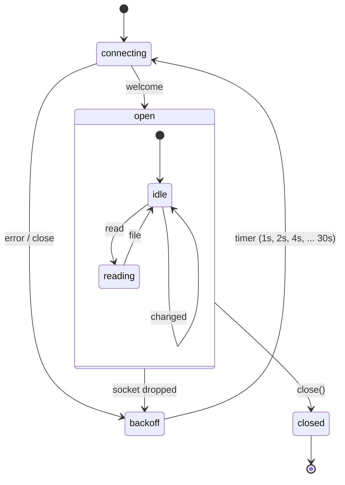
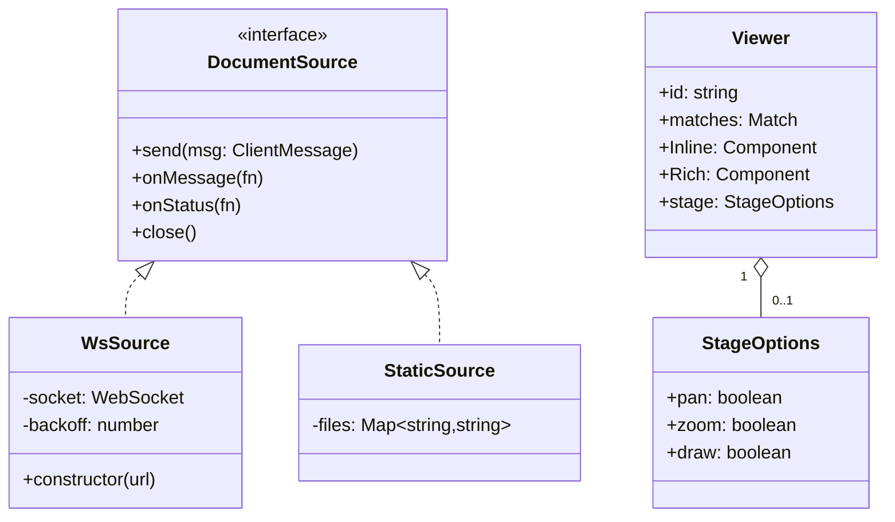
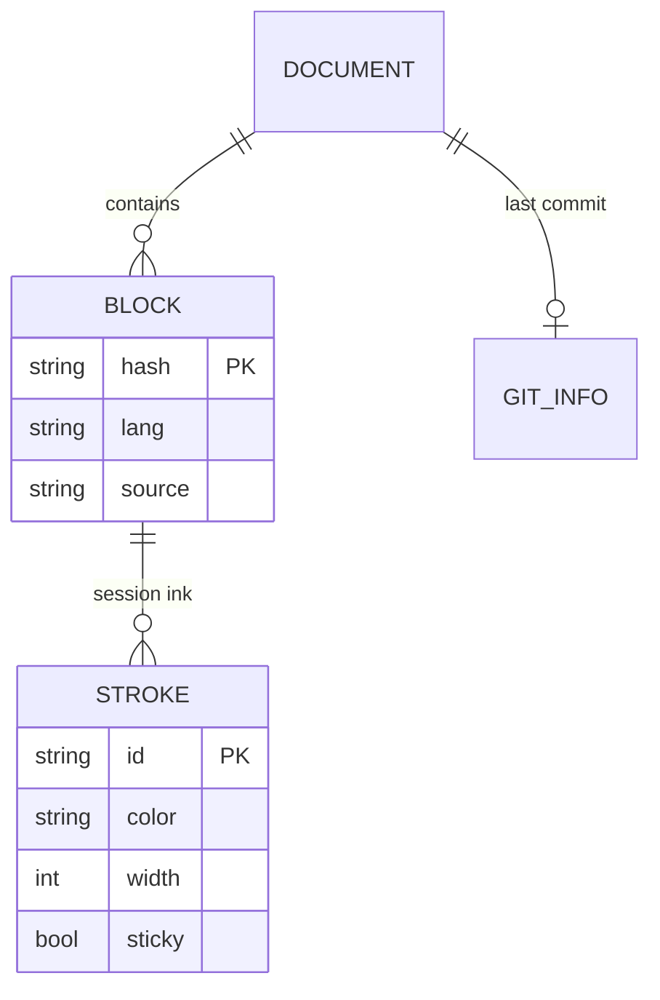
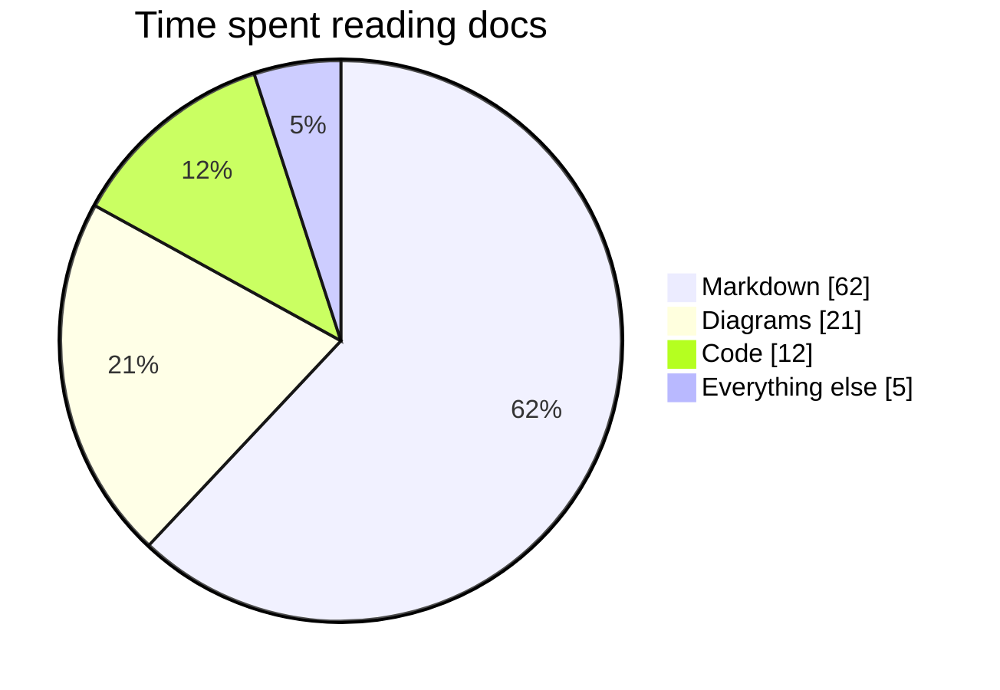
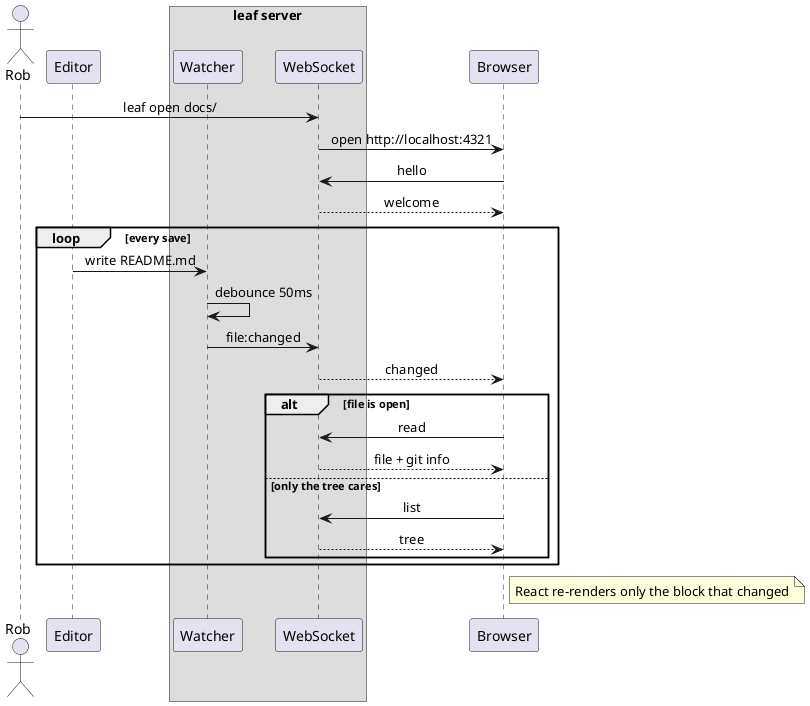
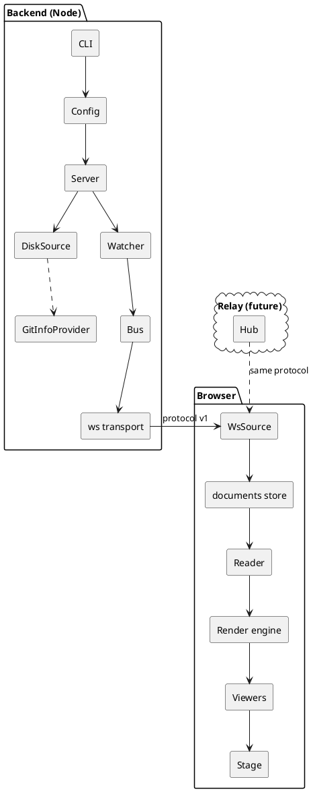
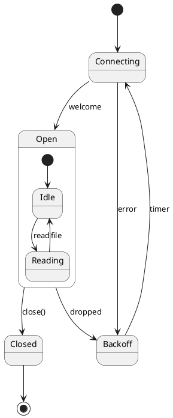

# Diagrams

Every diagram block has a hover toolbar: copy as image, copy source, download SVG, and zoom in. Zoom in opens the Stage: on a trackpad, pinch to zoom and two-finger scroll to move; with a mouse, wheel to zoom and drag with the hand to move. Draw with the pencil. Press `1` for the hand, `2` for the pencil, or hold `space` to drag while drawing. Ink fades unless you pin it sticky, which keeps it for this session; the eraser clears it.

## Mermaid

A flowchart with subgraphs, styled nodes, and labeled edges:



A sequence diagram with lifecycle blocks, notes, and a loop:



A state diagram for a WebSocket source:



A class diagram of the protocol:



An entity relationship diagram and a pie chart:





### A broken diagram

The parse error shows in place instead of a blank block:

```mermaid
flowchart LR
  A --> B --> --> C
```

## PlantUML

Renders when `PLANTUML_URL` is set (for example `https://www.plantuml.com/plantuml`); otherwise the source shows with a hint.







## Excalidraw

A hand-drawn sketch of the pieces, exported straight from the scene JSON:

```excalidraw
{"type":"excalidraw","version":2,"source":"leaf examples","elements":[{"angle":0,"strokeWidth":2,"strokeStyle":"solid","roughness":1,"opacity":100,"groupIds":[],"frameId":null,"seed":1,"version":1,"versionNonce":2,"isDeleted":false,"boundElements":[{"id":"disk-t","type":"text"}],"updated":1,"link":null,"locked":false,"fillStyle":"solid","id":"disk","type":"ellipse","x":0,"y":90,"width":160,"height":80,"strokeColor":"#8a6d1a","backgroundColor":"#fff3c4","roundness":null},{"angle":0,"strokeWidth":2,"strokeStyle":"solid","roughness":1,"opacity":100,"groupIds":[],"frameId":null,"seed":3,"version":1,"versionNonce":4,"isDeleted":false,"boundElements":[],"updated":1,"link":null,"locked":false,"fillStyle":"solid","id":"disk-t","type":"text","x":10,"y":118,"width":140,"height":24,"text":"Disk","originalText":"Disk","fontSize":18,"fontFamily":1,"textAlign":"center","verticalAlign":"middle","strokeColor":"#1d1d1f","backgroundColor":"transparent","containerId":"disk","lineHeight":1.25,"baseline":18,"roundness":null},{"angle":0,"strokeWidth":2,"strokeStyle":"solid","roughness":1,"opacity":100,"groupIds":[],"frameId":null,"seed":5,"version":1,"versionNonce":6,"isDeleted":false,"boundElements":[{"id":"relay-t","type":"text"}],"updated":1,"link":null,"locked":false,"fillStyle":"solid","id":"relay","type":"diamond","x":0,"y":230,"width":160,"height":80,"strokeColor":"#6b7280","backgroundColor":"#eef0f4","roundness":null},{"angle":0,"strokeWidth":2,"strokeStyle":"solid","roughness":1,"opacity":100,"groupIds":[],"frameId":null,"seed":7,"version":1,"versionNonce":8,"isDeleted":false,"boundElements":[],"updated":1,"link":null,"locked":false,"fillStyle":"solid","id":"relay-t","type":"text","x":10,"y":258,"width":140,"height":24,"text":"Relay","originalText":"Relay","fontSize":18,"fontFamily":1,"textAlign":"center","verticalAlign":"middle","strokeColor":"#1d1d1f","backgroundColor":"transparent","containerId":"relay","lineHeight":1.25,"baseline":18,"roundness":null},{"angle":0,"strokeWidth":2,"strokeStyle":"solid","roughness":1,"opacity":100,"groupIds":[],"frameId":null,"seed":9,"version":1,"versionNonce":10,"isDeleted":false,"boundElements":[{"id":"a1-t","type":"text"}],"updated":1,"link":null,"locked":false,"fillStyle":"solid","id":"a1","type":"arrow","x":170,"y":130,"width":130,"height":0,"points":[[0,0],[130,0]],"lastCommittedPoint":null,"startBinding":null,"endBinding":null,"startArrowhead":null,"endArrowhead":"arrow","strokeColor":"#1d1d1f","backgroundColor":"transparent","roundness":{"type":2}},{"angle":0,"strokeWidth":2,"strokeStyle":"solid","roughness":1,"opacity":100,"groupIds":[],"frameId":null,"seed":11,"version":1,"versionNonce":12,"isDeleted":false,"boundElements":[],"updated":1,"link":null,"locked":false,"fillStyle":"solid","id":"a1-t","type":"text","x":185,"y":104,"width":100,"height":20,"text":"fs events","originalText":"fs events","fontSize":14,"fontFamily":1,"textAlign":"center","verticalAlign":"middle","strokeColor":"#6b7280","backgroundColor":"transparent","containerId":"a1","lineHeight":1.25,"baseline":14,"roundness":null},{"angle":0,"strokeWidth":2,"strokeStyle":"dashed","roughness":1,"opacity":100,"groupIds":[],"frameId":null,"seed":13,"version":1,"versionNonce":14,"isDeleted":false,"boundElements":[{"id":"a2-t","type":"text"}],"updated":1,"link":null,"locked":false,"fillStyle":"solid","id":"a2","type":"arrow","x":170,"y":270,"width":130,"height":120,"points":[[0,0],[130,-120]],"lastCommittedPoint":null,"startBinding":null,"endBinding":null,"startArrowhead":null,"endArrowhead":"arrow","strokeColor":"#1d1d1f","backgroundColor":"transparent","roundness":{"type":2}},{"angle":0,"strokeWidth":2,"strokeStyle":"solid","roughness":1,"opacity":100,"groupIds":[],"frameId":null,"seed":15,"version":1,"versionNonce":16,"isDeleted":false,"boundElements":[],"updated":1,"link":null,"locked":false,"fillStyle":"solid","id":"a2-t","type":"text","x":185,"y":184,"width":100,"height":20,"text":"protocol","originalText":"protocol","fontSize":14,"fontFamily":1,"textAlign":"center","verticalAlign":"middle","strokeColor":"#6b7280","backgroundColor":"transparent","containerId":"a2","lineHeight":1.25,"baseline":14,"roundness":null},{"angle":0,"strokeWidth":2,"strokeStyle":"solid","roughness":1,"opacity":100,"groupIds":[],"frameId":null,"seed":17,"version":1,"versionNonce":18,"isDeleted":false,"boundElements":[{"id":"server-t","type":"text"}],"updated":1,"link":null,"locked":false,"fillStyle":"solid","id":"server","type":"rectangle","x":310,"y":110,"width":220,"height":100,"strokeColor":"#1e8e4d","backgroundColor":"#dff5e6","roundness":{"type":3}},{"angle":0,"strokeWidth":2,"strokeStyle":"solid","roughness":1,"opacity":100,"groupIds":[],"frameId":null,"seed":19,"version":1,"versionNonce":20,"isDeleted":false,"boundElements":[],"updated":1,"link":null,"locked":false,"fillStyle":"solid","id":"server-t","type":"text","x":320,"y":148,"width":200,"height":24,"text":"leaf server","originalText":"leaf server","fontSize":18,"fontFamily":1,"textAlign":"center","verticalAlign":"middle","strokeColor":"#1d1d1f","backgroundColor":"transparent","containerId":"server","lineHeight":1.25,"baseline":18,"roundness":null},{"angle":0,"strokeWidth":2,"strokeStyle":"solid","roughness":1,"opacity":100,"groupIds":[],"frameId":null,"seed":21,"version":1,"versionNonce":22,"isDeleted":false,"boundElements":[{"id":"a3-t","type":"text"}],"updated":1,"link":null,"locked":false,"fillStyle":"solid","id":"a3","type":"arrow","x":540,"y":160,"width":130,"height":0,"points":[[0,0],[130,0]],"lastCommittedPoint":null,"startBinding":null,"endBinding":null,"startArrowhead":null,"endArrowhead":"arrow","strokeColor":"#1d1d1f","backgroundColor":"transparent","roundness":{"type":2}},{"angle":0,"strokeWidth":2,"strokeStyle":"solid","roughness":1,"opacity":100,"groupIds":[],"frameId":null,"seed":23,"version":1,"versionNonce":24,"isDeleted":false,"boundElements":[],"updated":1,"link":null,"locked":false,"fillStyle":"solid","id":"a3-t","type":"text","x":555,"y":134,"width":100,"height":20,"text":"WebSocket","originalText":"WebSocket","fontSize":14,"fontFamily":1,"textAlign":"center","verticalAlign":"middle","strokeColor":"#6b7280","backgroundColor":"transparent","containerId":"a3","lineHeight":1.25,"baseline":14,"roundness":null},{"angle":0,"strokeWidth":2,"strokeStyle":"solid","roughness":1,"opacity":100,"groupIds":[],"frameId":null,"seed":25,"version":1,"versionNonce":26,"isDeleted":false,"boundElements":[{"id":"browser-t","type":"text"}],"updated":1,"link":null,"locked":false,"fillStyle":"solid","id":"browser","type":"rectangle","x":680,"y":90,"width":220,"height":140,"strokeColor":"#3e82f7","backgroundColor":"#e8f0fe","roundness":{"type":3}},{"angle":0,"strokeWidth":2,"strokeStyle":"solid","roughness":1,"opacity":100,"groupIds":[],"frameId":null,"seed":27,"version":1,"versionNonce":28,"isDeleted":false,"boundElements":[],"updated":1,"link":null,"locked":false,"fillStyle":"solid","id":"browser-t","type":"text","x":690,"y":148,"width":200,"height":24,"text":"Reader","originalText":"Reader","fontSize":18,"fontFamily":1,"textAlign":"center","verticalAlign":"middle","strokeColor":"#1d1d1f","backgroundColor":"transparent","containerId":"browser","lineHeight":1.25,"baseline":18,"roundness":null},{"angle":0,"strokeWidth":2,"strokeStyle":"solid","roughness":1,"opacity":100,"groupIds":[],"frameId":null,"seed":29,"version":1,"versionNonce":30,"isDeleted":false,"boundElements":[{"id":"stage-t","type":"text"}],"updated":1,"link":null,"locked":false,"fillStyle":"solid","id":"stage","type":"rectangle","x":680,"y":280,"width":220,"height":80,"strokeColor":"#e5484d","backgroundColor":"#ffe5e6","roundness":{"type":3}},{"angle":0,"strokeWidth":2,"strokeStyle":"solid","roughness":1,"opacity":100,"groupIds":[],"frameId":null,"seed":31,"version":1,"versionNonce":32,"isDeleted":false,"boundElements":[],"updated":1,"link":null,"locked":false,"fillStyle":"solid","id":"stage-t","type":"text","x":690,"y":308,"width":200,"height":24,"text":"Stage: zoom + ink","originalText":"Stage: zoom + ink","fontSize":18,"fontFamily":1,"textAlign":"center","verticalAlign":"middle","strokeColor":"#1d1d1f","backgroundColor":"transparent","containerId":"stage","lineHeight":1.25,"baseline":18,"roundness":null},{"angle":0,"strokeWidth":2,"strokeStyle":"solid","roughness":1,"opacity":100,"groupIds":[],"frameId":null,"seed":33,"version":1,"versionNonce":34,"isDeleted":false,"boundElements":[],"updated":1,"link":null,"locked":false,"fillStyle":"solid","id":"a4","type":"arrow","x":790,"y":240,"width":0,"height":30,"points":[[0,0],[0,30]],"lastCommittedPoint":null,"startBinding":null,"endBinding":null,"startArrowhead":null,"endArrowhead":"arrow","strokeColor":"#1d1d1f","backgroundColor":"transparent","roundness":{"type":2}},{"angle":0,"strokeWidth":2,"strokeStyle":"solid","roughness":1,"opacity":100,"groupIds":[],"frameId":null,"seed":35,"version":1,"versionNonce":36,"isDeleted":false,"boundElements":[],"updated":1,"link":null,"locked":false,"fillStyle":"solid","id":"title","type":"text","x":310,"y":0,"width":300,"height":40,"text":"leaf, roughly","originalText":"leaf, roughly","fontSize":32,"fontFamily":1,"textAlign":"left","verticalAlign":"top","strokeColor":"#1d1d1f","backgroundColor":"transparent","containerId":null,"lineHeight":1.25,"baseline":28,"roundness":null}],"appState":{"viewBackgroundColor":"#ffffff","gridSize":null},"files":{}}
```

## Drawing

A ` ```draw ` block is a blank sheet: draw on it with the mouse, pen, or a finger. Hover it for the ink colors, **invisible ink** (strokes fade away), **undo** (or <kbd>⌘Z</kbd> with the sheet focused), and **clear**, then **Copy as image** or **Download SVG** to keep what you drew. Drawings last until you close leaf; nothing is written to the file.

```draw
size: 800x360
A scratch pad for this page.
```

`size: 800x360` sets the sheet; any other text in the block is a note to yourself (two blocks with the same text share one drawing).

## Standalone files

The same viewers open files on their own: [flow.mmd](./diagrams/flow.mmd), [sequence.puml](./diagrams/sequence.puml), and [sketch.excalidraw](./diagrams/sketch.excalidraw), each ready to pan, zoom, and draw on. [whiteboard.draw](./diagrams/whiteboard.draw) is a sheet that fills the window, with its tools in the file toolbar.
